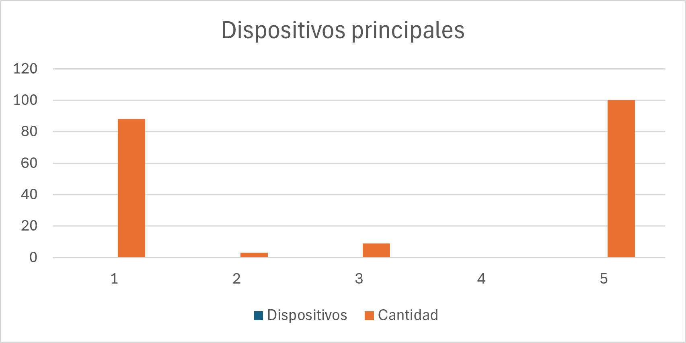

# Uso de Redes Sociales en Estudiantes Universitarios

## Descripción del proyecto

Este proyecto busca analizar los hábitos de uso de las redes sociales en estudiantes universitarios, teniendo en cuenta las plataformas que utilizan, el tiempo que les dedican, sus principales propósitos de uso y la influencia que perciben en su productividad académica.

El proyecto se desarrolla como parte de un portafolio de análisis de datos.

## Pregunta de investigación

¿Cómo utilizan las redes sociales los estudiantes universitarios en su vida diaria y qué influencia perciben en su productividad académica?

## Objetivo

Analizar los hábitos de uso de las redes sociales mediante tablas de frecuencia y gráficas, con el fin de identificar patrones dentro de un conjunto de datos de práctica.

## Herramientas utilizadas

- **Microsoft Excel:** organización de datos, elaboración de tablas de frecuencia y creación de gráficas.
- **GitHub:** almacenamiento y documentación del proyecto.

## Datos utilizados

Para este proyecto se utilizaron 100 registros de datos simulados con fines educativos. Estos registros no corresponden a una encuesta real ni representan necesariamente los hábitos de la población universitaria.

Las variables analizadas son:

- Carrera universitaria.
- Plataforma principal utilizada.
- Tiempo diario dedicado a las redes sociales.
- Propósito principal de uso.
- Momento del día de mayor uso.
- Dispositivo principal.
- Influencia percibida en la productividad académica.

## Análisis realizados

Se realizó un análisis descriptivo mediante tablas de frecuencia y gráficas para explorar las siguientes preguntas:

1. ¿Cuáles son las plataformas más utilizadas en los datos?
2. ¿Cuánto tiempo diario se dedica a las redes sociales?
3. ¿Cuál es el propósito principal de uso?
4. ¿En qué momento del día se utilizan más?
5. ¿Qué dispositivos se utilizan principalmente?
6. ¿Qué influencia perciben los registros en la productividad académica?

## Resultados destacados

- **Plataformas:** TikTok fue la categoría más frecuente, con 42 registros.
- **Tiempo diario:** la categoría «Más de 8 horas» fue la más frecuente, con 30 registros.
- **Propósito de uso:** entretenimiento fue la categoría más frecuente, con 48 registros.
- **Momento de uso:** tarde y noche empataron como las categorías más frecuentes, con 29 registros cada una.
- **Dispositivo:** celular fue la categoría más frecuente, con 88 registros.
- **Productividad académica:** la categoría «Negativamente» fue la más frecuente, con 44 registros.

Estos resultados describen únicamente los datos simulados utilizados para practicar el análisis.

## Estado del proyecto

- [x] Definición del problema.
- [x] Creación de datos simulados.
- [x] Elaboración de tablas de frecuencia.
- [x] Creación de gráficas.
- [ ] Interpretación y documentación final de los resultados.

## Próximos pasos

- Redactar las conclusiones del análisis.
- Revisar la presentación de las gráficas.
- Completar la documentación del proyecto.

## Nota

Este proyecto tiene fines educativos. Los datos son simulados y no deben interpretarse como resultados de una investigación real.

## Conclusiones

A partir del análisis descriptivo de los 100 registros simulados, se identificaron los siguientes patrones dentro del conjunto de datos:

1. **Plataforma principal:** TikTok fue la plataforma más frecuente, con 42 registros, seguida de Instagram, con 32.

2. **Tiempo diario de uso:** la categoría más frecuente fue más de 8 horas al día, con 30 registros. Le siguieron las categorías de 5 a 6 horas, con 25, y de 7 a 8 horas, con 24.

3. **Propósito principal:** el entretenimiento fue el propósito más frecuente, con 48 registros, seguido de la comunicación, con 27.

4. **Momento de mayor uso:** la tarde y la noche empataron con 29 registros cada una. También se registraron respuestas para el mediodía y el almuerzo, y para el uso durante todo el día.

5. **Dispositivo principal:** el celular fue el dispositivo predominante, con 88 registros, mientras que la tableta representó 9 y el computador 3.

6. **Influencia percibida en la productividad académica:** la respuesta más frecuente fue «Negativamente», con 44 registros. Otras 17 respuestas correspondieron a «Muy negativamente», mientras que 22 indicaron que no percibían influencia.

En general, los datos simulados muestran una mayor frecuencia de uso de TikTok, una preferencia por el entretenimiento y un predominio del celular. También se observa que la respuesta negativa fue la más frecuente al preguntar por la influencia percibida en la productividad académica.

**Limitación:** estos resultados se obtuvieron a partir de datos simulados con fines educativos. Por lo tanto, no representan una encuesta real y no permiten generalizar conclusiones sobre todos los estudiantes universitarios ni establecer relaciones de causa y efecto.

## Gráficas del análisis

### Plataforma principal de redes sociales

### Tiempo diario dedicado a las redes sociales

### Propósito principal

### Momento de mayor uso

### Dispositivos utilizados

### Influencia en la productividad académica

